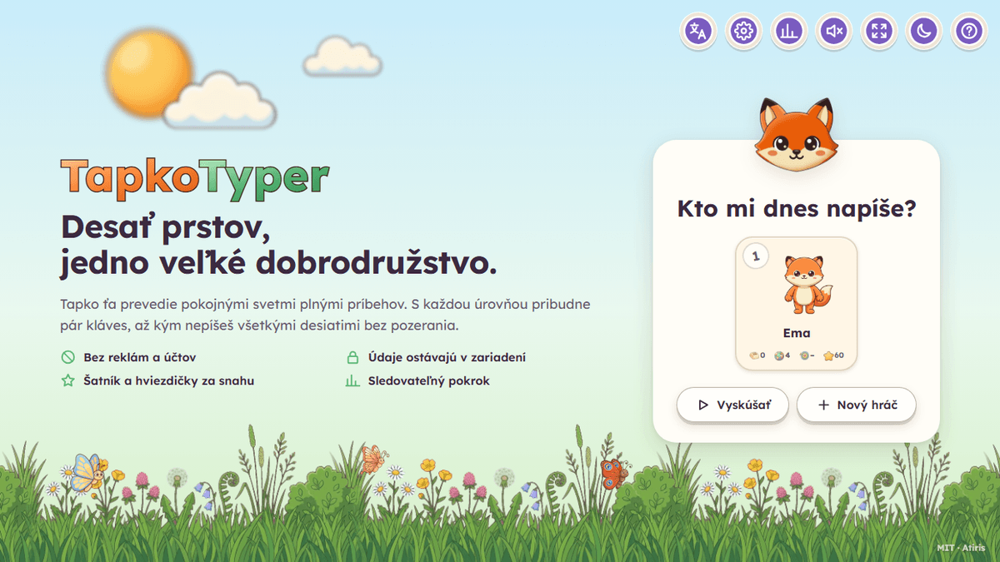
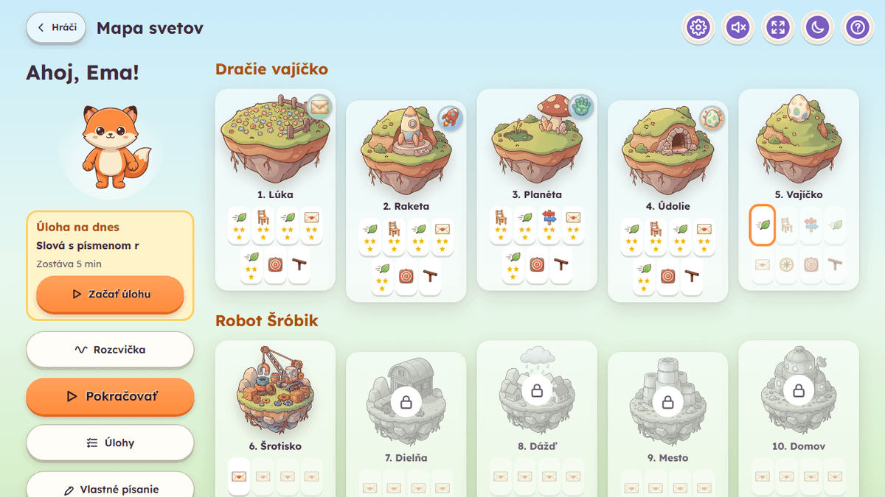
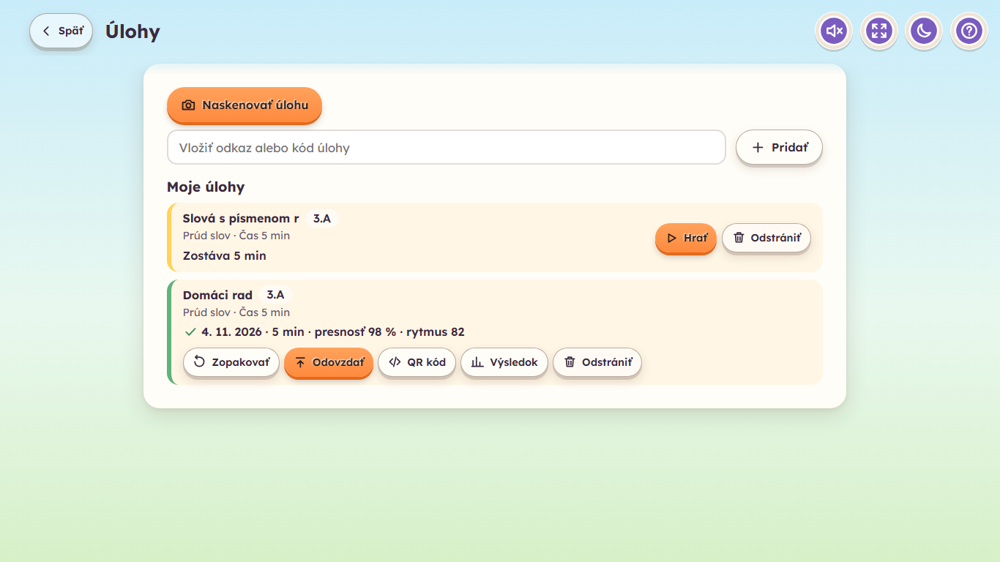
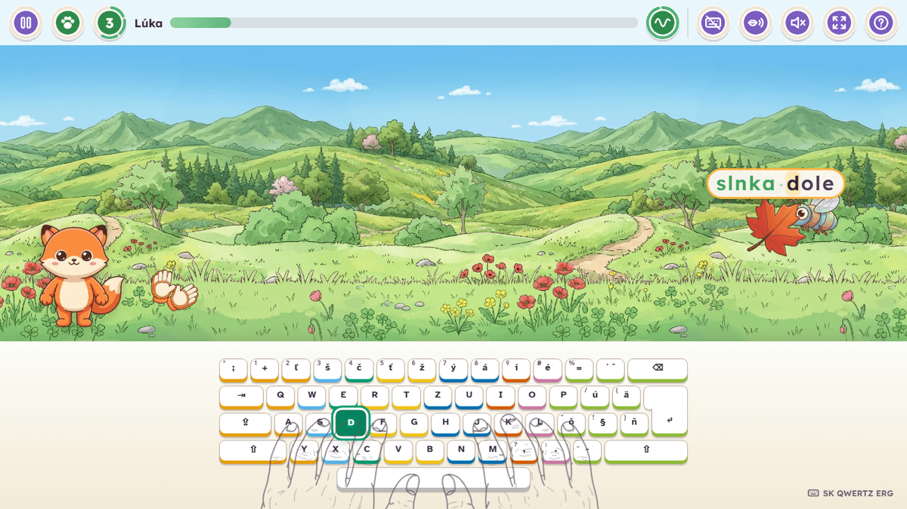
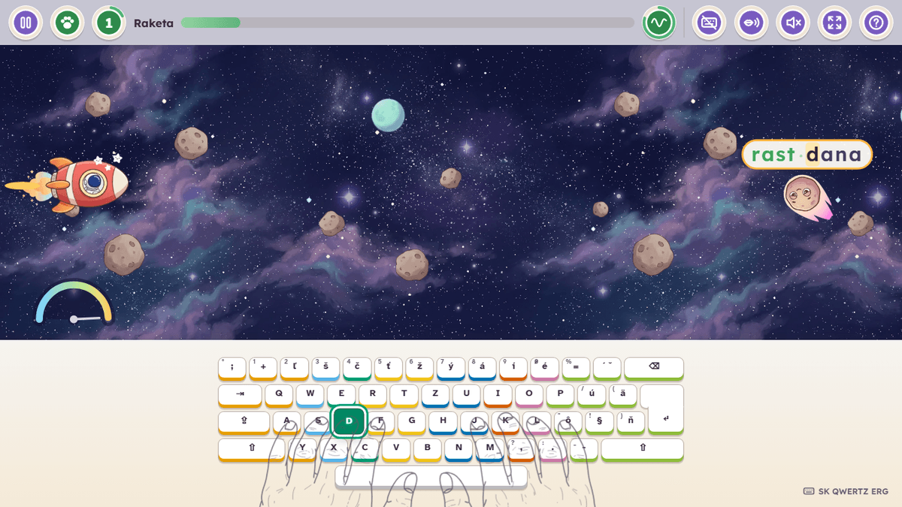
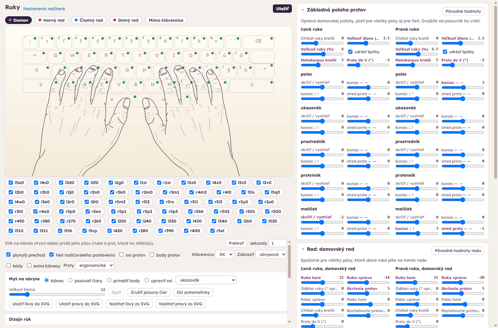
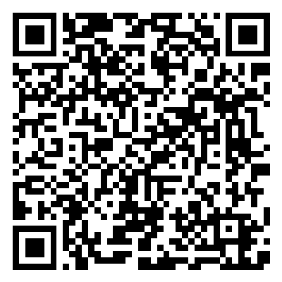

# TapkoTyper

A peaceful, story-driven touch-typing adventure for children (about 10-15 years).
Kids learn to type with **all ten fingers** as their own **character**: they keep goal for the
meadow animals, fly a rocket through a meteor belt, bring the light back to the dragons' planet
and teach the baby dragons to fly. Later stories (the little robot Bolt, the fairy Melody) are
being made. No explosions, no punishment, no ads, no accounts.

*Pokojná príbehová hra pre deti na nácvik písania všetkými desiatimi. Po slovensky aj po anglicky.*

**Play:** https://tapkotyper.com/ · **Support:** [Ko-fi](#support)



## How it teaches

- **One key at a time.** Keys unlock from the home row (`F` `J`, then `D` `K`, `S` `L` ...),
  each new key is introduced alone (where it is, which finger), then mixed with known keys.
  The next keys unlock when the newest ones are ready (their last 25 presses, or 12 for a
  punctuation key, at least 90 % right and in a calm rhythm).
- **Real sentences early.** Space comes with the first keys, period and comma with the
  letters, and capitals in the middle of the path, one Shift at a time; targets grow from
  `fj jf` to short phrases like `Ema ide.`
- **Every key has its finger.** Each new key gets its own card (where it is, which finger),
  and after `F` and `J` a card shows the home row. The on-screen keyboard shows finger colors
  and numbers, lights up the next key (and both steps of Slovak accent keys), and two hands
  show which finger to use. The guide fades for keys the child already masters.
- **Accuracy before speed.** Stars come from accuracy, 1 to 5, each further star for half the mistakes; speed is
  only a personal trend. Mistakes never cost anything: the letter wobbles, the right key glows,
  and after three misses on one key the character shows which key it is and which finger presses it.
  Backspace wipes a started word, so the child can start another one.
- **Weak keys come more often**, and "My progress" (click the character) shows which keys to
  practise, with a one-minute drill.
- **Grows with the child.** Difficulty and word length go up in small automatic steps
  after a few minutes of accurate play where few words floated by, and every step earns a
  medal. Words move at the child's own word pace (reading included), and when two pass by
  in a row the next ones come slower.
- **Levels open with keys.** Each level needs a few more known keys than the one before
  (the first story starts at 3 and ends at 20), so every new key opens new levels with
  varied words.
- **Worlds count on keys, not letters.** Each world has a fixed list of keys, named by place,
  that the child knows on entering it; Help (Progress, "Worlds and keys") shows them all.
- **Side activities per world.** When a world's big challenge is done, two voluntary cards
  open on the map. The **target range** throws funny things through rings of words that train
  exactly the letters holding the next ones back. The **parrot** makes the fingers learn a few
  words by typing them many times over; keep the Parrot badge and Aro the parrot joins the character.
  **Just typing** is a free sandbox: type anything, the character shows and says it, nothing is counted.
- **A story worth following.** Each level opens with one get-ready card that tells what
  happens and what to type; nothing else stands between the child and play except the key
  cards. Each world has its own twists (a hop across meteors, a crossroads where the chosen
  sign changes the road, a lullaby copied word by word), and the parent's own surprises
  (below) give real rewards.
- **Paw help.** Fifteen words in a row without a mistake charge a paw (three at most): on
  Enter, the character's paws replace the hands and type the three closest words, which never count
  in the stats.
- **Per-key stats** count only the last 50 presses, show what a key is mixed up with and
  how it changed day by day; click any key on the stats keyboard. "My progress" is its own
  page with badges, the treasure chest and range awards.
- **Good habits:** the get-ready card ("The adventure goes on!") shows a boy or a girl
  sitting well, with one preparation tip each session (over 40 tips) or a posture reminder;
  the space bar starts. The map has a warm-up button, and after the session length the
  parent chose comes a stretch break (a longer "big break" can be added; anyone may skip it
  unless the parent locks it).
- **Slovak keyboards done right:** QWERTZ and QWERTY variants, `ľ š č ť ž ý á í é` on the
  number row, `ú ä ô ň`, dead keys for `ó ĺ ŕ ď` and accented capitals, and a hint when
  the real keyboard looks different.

## The game

**Story 1: The Dragon Egg**

| World | What happens | Big challenge | Reward |
|---|---|---|---|
| 1. Training Meadow | the goalkeeper character catches the leaves bees, ladybugs and mice kick at him (a miss is a cheered goal); a poppy bouquet, the match, party invitations | hedgehog throwing leaf volleys | invitation to space |
| 2. Rocket Flight | typing speed drives the speedometer (slower without mistakes is better), a beam pushes rocks away; hops across meteors, commands to the rocket | fractured asteroid | landing clearance |
| 3. New Planet | stones across a swamp, crystals on the meadow, crossroads that change the road, spells for the crystals of life | the great swamp and a floating log | the Force |
| 4. Dragon Valley | flames light the dragons' fire, spells clear the overgrown path, flying lessons, a lullaby | the take-off: every dragon flies away | a dragon egg |
| 5. Egg Journey *(being made)* | the egg jumps over rocks and stumps | friendly mole | a baby dragon, endless rescue missions |

Worlds 5-15 are still being made: until a world is built, its levels play one simple copying
game, so the child keeps progressing and new keys keep coming. The tables below are the plan.

**Story 2: Bolt the Robot** (opens at 10 known keys; Bolt walks next to the character)

| World | What happens | Big challenge | Reward |
|---|---|---|---|
| 6. Junkyard | a magnet crane lifts junk off the pile where Bolt beeps | tangled cable knot | Bolt becomes a friend |
| 7. Workshop | parts on a conveyor belt go into Bolt's basket | battery charged by rhythm | new legs and antenna |
| 8. Rain | The character's umbrella catches raindrops before Bolt gets wet | grumpy storm cloud | a raincoat and an umbrella |
| 9. City | doors open with passwords typed on their panels | main gate: a long code without a mistake | the home key card |
| 10. Home | lamps switch on and helper robots wake up | little robots popping out of boxes | Bolt's family, little robots in rescue missions |

**Story 3: Melody the Fairy** (opens at 20 known keys; Melody floats next to the character)

| World | What happens | Big challenge | Reward |
|---|---|---|---|
| 11. Garden | typed words open humming buds | the sleeping flower, woken by dictated words | the garden's song, a flower wreath |
| 12. Path | birds sing their words (dictation) and fly along | the owl's riddles, word by word | a feather |
| 13. Lake | words reflected on the water fade (memory), lilies bloom | the long reflection, shown once | a water lily |
| 14. Tree | notes sing or glow and fade, in turns | the tree's song to a calm beat | a little harp |
| 15. Ball | fireflies bring sung sentences to the dance floor | the last song | fairy wings, forest friends in rescue missions |

Every finished world gives a badge that turns silver and gold with more stars.
Rescued dragons, repaired robots and forest friends guided home collect on the Little friends screen.

The character can be one of nine animals and wears 47 accessories earned by progress (never by chance).
Time in the wardrobe is earned by practice: a fifth of the training time, with a calm countdown.
A printable certificate (portrait, with a fox frame; Aro signs it with the badge) comes with the
progress card.
A few secret words do something too: try saying hello on the start page, or typing a word you
see on the map or in My progress.






## For parents

- **Private:** 100 % in the browser. No backend, no tracking, no cookies. Profiles stay in
  `localStorage` and can be exported / imported as a `.json` file. Guest mode keeps nothing.
  Links (tasks, results, moving a player) carry their data in the address hash, which never
  reaches a server.
- **Parent area** (gear button, one confirm question; the settings also work without a player): child and companion names, keyboard layout, active keys (automatic or picked by hand), word
  length and difficulty 1-10 (automatic or fixed), words without diacritics, no time pressure, session length,
  unskippable breaks, guide visibility, read typed words aloud, wardrobe time, Ms Turtle's tips
  about the app on the map, volumes, fonts (Lexend, Atkinson Hyperlegible, OpenDyslexic), large
  text, reduced motion, high contrast, and graphics (Automatic, Full or Simple: Simple draws
  less for slow computers and plays the same; Automatic switches to it when the game runs
  slowly). A dashboard shows a per-key heat map, accuracy and speed trends, time per day, and
  a printable progress card. All profiles can be deleted at once.
- **Own content** (its own tab): encouraging messages, own words (for example this week's
  spelling words) and an own text, mixed into the levels by a share you pick. The text can
  also be typed in order as free practice ("My text").
- **Surprises** (their own tab): this is meant for real rewards. Write a question ("Do you
  know where Dad hid a sweet reward?") and the answer ("In the cupboard behind the
  fridge."), and say when the answer comes: after a given level, after some minutes of
  training, or after some more levels or stars. The get-ready card asks the question (with
  what is still left) and the results show the answer right under it when the time comes,
  once or again and again. A closed golden box on the map lists the waiting surprises and
  what they still need; won ones stay on the map for the days you choose. One table shows
  every surprise and its state.
- **Translate the game:** a parent page (its button ends the "Sounds and interface" settings) shows every text of
  the game with its situation (explained in English, beside a sample language you pick), and makes a new language or a corrected copy of one. Export and
  import as pair files (handy for an AI translator) or `.json`; progress is shown per section.
- **Reading aloud:** a button in the level bar reads the word to type and the companion's
  lines with the browser's own voice (shown when the browser has one for the language).
- **Direct links:** each child's map has its own address (`tapkotyper.com/#/p/<id>`), so you
  can bookmark it or put it on the desktop. Leaving the app asks first.
- **Quick sound button:** normal, quiet (20 %) or off.
- **Super mode (secret password):** on the start screen, type `supertapkotyper` quickly
  (within 4 seconds, no text field needed). A temporary "Super Tapko" player opens with
  every world, level, key and accessory unlocked, to look around or test; a service menu under
  the star can fill its progress, and "super help" can type a level like a player. Nothing it does
  is saved or counted in anyone's statistics; end it with the star in the top right corner or a reload.
  It can also remove or change the settings password set before, without knowing it (for a
  forgotten password); the settings then show a warning for a month.
- **Offline:** installable PWA; works without internet after the first visit.
- **Move to another computer:** the data tab makes a link (and a QR code) with the whole
  player; open it on the other computer. Very large profiles go by file export instead.

## For teachers

No accounts and no server: tasks and results travel as links you send yourself (Edupage,
e-mail), with the data inside the link.

- **Give a task:** "For teachers", tab **Tasks**: a name, the group, the game, the words or a
  text, the limit (time, text or both) and a few options. **Prepared tasks** shows its QR code,
  copies its link or opens the big code.
- **The child** opens the link (or scans the code on its Tasks page), picks their player (or makes
  a new one) and sees "Today's task" first on the map. When the task is done, "Hand in" gives a
  result link and a QR code for the teacher.
- **Results:** "For teachers", the chart button at the top right of the start page (no keyboard
  needed, so a phone works). **Scan QR** reads the codes on the children's screens with the
  camera, several at once; a result link opened or pasted is added too. A new student goes into
  the task's group, a student you know stays in their group, and a child stays one student even
  after renaming the profile. Everything is kept in your browser only.
- **Evaluation:** the sets of each group, the students (move several into a group at once, open
  one student's progress) and CSV export. The **Data** tab exports and imports `.tapko` files
  (double-click opens one in Chrome or Edge), so a class's history scanned on a phone moves to
  one computer, and renames, merges or deletes groups, students and files. A checksum shows
  damaged links; it does not stop cheating. The help's "Parents and teachers" tab explains it all.

## Development

Requires Node.js 24+.

```sh
npm ci
npm run dev      # http://localhost:5173/
npm run build    # type check + production build into dist/
npm test         # unit tests (Vitest)
npm run test:e2e # browser tests (Playwright)
npm run assets   # turn raw images and music in assets-src/ into web files in public/assets/
npm run icons    # render the favicon and the PWA icons from ui-icon (after npm run assets)
```

### The hand tool

The outline hands over the on-screen keyboard show for every key how a real hand types it. They are designed in
the hand tool, a page of the dev server only (it never goes into the build):

```sh
npm run dev      # then open http://localhost:5173/tools/hand-poser/ (the address vite prints)
```

In free typing on the dev server, the paw button opens it on the pose of the key typed last.



One drawing per hand (`tools/hand-poser/drawing/lx2.svg`, `rx2.svg`, Inkscape, middle lines with a width) is the
home position; every other pose moves its points by rules, so the hands always keep one look:

- **Základná poloha prstov**: corrections of the home position (each finger bent, moved, apart in a V), the
  palm, the whole hand's size (with the fingertips kept on their keys), the metacarpus.
- **Rows** (the badges above the keyboard: home, top, digit and bottom row, beside the keyboard): where the whole
  hand goes and how the fingers curl on that row. A coloured dot on a badge is the colour of its shadow under the
  poses made from it.
- **Key poses** (the badges below the keyboard): a click on a key opens or adds the pose of the finger that presses
  it (the layout and the fingering, standard or ergonomic, are switched above the tools); each pose adds its own
  small moves of the hand and of every finger. "Kopírovať" and "Vložiť" copy one pose over another.
- **Mouse tools**: move the outline's lines with a brush, give points to a finger by hand, edit the fingers' axes.
- **Dizajn rúk**: the lines' widths, colours and transparency over and beside the keyboard; **Farby prstov a
  nechty**: the palette being tried and which poses get coloured nails.

"Uložiť" (Ctrl+S) writes the settings (`tools/hand-poser/rows.json`), the edited home outlines
(`tools/hand-poser/outline/<side>.svg`), one SVG per pose (`public/hands/<side>/<name>.svg` with
`public/hands/index.json`) and the look (`src/ui/hand-style.ts`); "Použiť farby v Ťapkovi" writes the palette into
`src/ui/finger-colors.ts`. An open Tapko on the dev server shows a save at once. On another computer the
repository holds everything: `npm ci`, `npm run dev`, open the tool. Pose names and the owner's rules for the hands
are in [`assets-src/PROMPTS.md`](assets-src/PROMPTS.md), section 12.

For quick manual testing, open the dev server with `?fast` before the hash
(`http://localhost:5173/?fast#/`): level minimums, the stretch break and
the play time before a break all take a sixth of their time. A browser driver types through
`window.tapkoType('text')` (dev and e2e builds): it sends the player's layout's real keys, with
Shift and dead keys, so `ô`, `ä` or `Ľ` work where a driver's own typing sends US keys.

The game must run well on weak school computers (slow processor, little memory, no graphics
card worth counting on). `node scripts/perf.mjs` measures frame times per level on a normal and
a slowed-down computer with software drawing; `--budget` fails when a level is over the budget
in [`.specify/architecture.md`](.specify/architecture.md).

Every push to `main` builds the site and deploys it to GitHub Pages
(`.github/workflows/deploy.yml`).

## Project docs

- [`.specify/`](.specify/) - what the product does and why, per feature
- [`.research/`](.research/) - research of similar products and proposed features
- [`.todo/`](.todo/) - implementation plans, queue and backlog
- [`.scenarios/`](.scenarios/) - end-to-end test scenarios
- [`assets-src/PROMPTS.md`](assets-src/PROMPTS.md) - Gemini prompts for images and music

## Support

TapkoTyper is free and made in my free time; the only real cost is the domain. If you want to
help, buy me a "coffee": it pays the domain for another year, and anything left over goes to
real coffee :) Thank you.

*Ak chcete podporiť tento projekt (reálne platím len za doménu, čas mu venujem zadarmo), môžete
mi poslať „kávu“. Kúpim za to doménu na ďalší rok a čo zvýši, pôjde na skutočnú kávu :) Ďakujem.*

<a href="https://ko-fi.com/atiris"></a>

<details>
<summary>Bank transfer / Prevod na účet (PAY by square)</summary>



IBAN: `SK7283605207004200851983` (Jozef Pažin)

</details>

## License

[MIT](LICENSE). Fonts: SIL Open Font License (see `public/fonts/`). The names TapkoTyper and Ťapko, the characters and the logo are not part of the MIT license, see [TRADEMARKS.md](TRADEMARKS.md).
